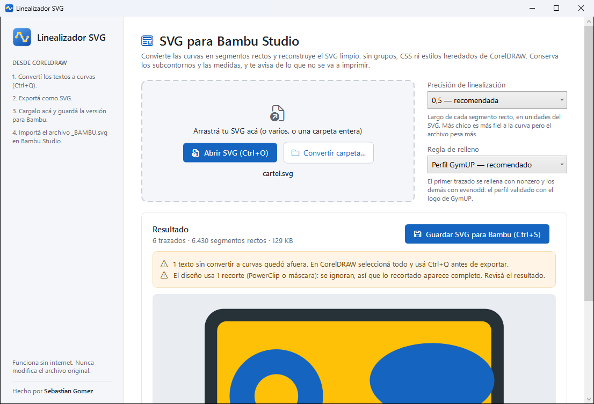
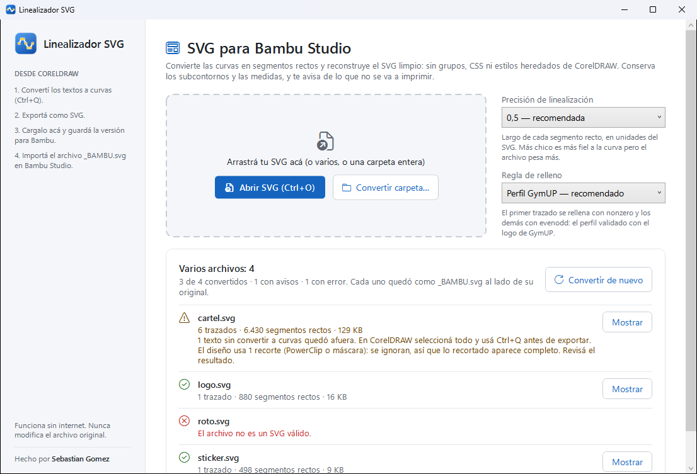

<div align="center">


# Linealizador SVG

**Pasá tus diseños de CorelDRAW a Bambu Studio sin sorpresas: curvas convertidas en segmentos rectos, SVG limpio y huecos que se respetan.**


</div>

---

<p align="center">
  
</p>

## 🤔 ¿Para qué sirve?

Un SVG exportado de CorelDRAW trae **curvas Bézier, grupos anidados, clases CSS y transformaciones**. Al importarlo en Bambu Studio pasa seguido que aparezcan partes rellenas que tendrían que estar huecas, contornos deformados o piezas que directamente no se importan.

Esta app reconstruye el archivo como Bambu lo entiende mejor: **solo trazados con segmentos rectos, en coordenadas absolutas, cada uno con su color y su regla de relleno**. Las medidas del documento no cambian, así que la pieza sale del tamaño que la diseñaste.

## ✨ Funcionalidades

### Convertir

| | |
|---|---|
| 📐 **Linealiza las curvas** | Bézier cúbicas y cuadráticas (también las suaves `S` y `T`) y arcos elípticos pasan a segmentos rectos |
| 🎚️ **Precisión a elección** | 0,25 (más detalle), 0,5 (recomendada), 0,8 o 1,0 (archivo más liviano). Al cambiarla se vuelve a convertir sola |
| 🧹 **SVG limpio** | Sin grupos, clases CSS, `<defs>` ni estilos heredados: cada trazado lleva su color escrito |
| 🔷 **Formas nativas** | Rectángulos (también redondeados), círculos, elipses y polígonos que CorelDRAW exporta como tales se convierten igual que los trazados |
| 🔄 **Aplica las transformaciones** | `translate`, `scale`, `rotate`, `skew` y `matrix` de los grupos quedan aplicadas a las coordenadas. Los símbolos reutilizados (`<use>`) se dibujan donde se usan |
| 📏 **Mismas medidas** | Conserva `width`, `height` y `viewBox`; si falta el `viewBox`, lo arma con el tamaño |
| 🛟 **Nunca toca el original** | Guarda una copia aparte, `diseño_BAMBU.svg`, en la misma carpeta |

### Rellenos y huecos

| Regla | Qué hace |
|---|---|
| 🏋️ **Perfil GymUP** *(recomendado)* | El primer trazado con *nonzero* y los demás con *evenodd*: el perfil validado con el logo de GymUP, igual que la versión web |
| 📄 **Como viene en el archivo** | Cada trazado conserva la regla que le puso CorelDRAW |
| ➰ **Todo nonzero** | Rellena según el sentido de cada contorno |
| ◐ **Todo evenodd** | Alterna relleno y hueco en cada contorno anidado |

La 👀 **vista previa** compara lado a lado el **original sin convertir**, con los trazados que Bambu suele romper marcados en rojo (curvas más varias piezas separadas en un mismo trazado: el importador de Bambu arma la más grande y trata las demás como huecos, y salen deformadas), y cómo queda **convertido**, con sus rellenos: si un hueco aparece tapado, probás otra regla y ves el cambio al instante.

### Avisos: lo que no se va a imprimir

Antes de mandar a imprimir, la app te avisa si el diseño tiene:

- ✏️ **Textos sin convertir a curvas**: quedan afuera (en CorelDRAW, `Ctrl+Q`).
- 🖼️ **Imágenes** (bitmaps): no se pueden convertir en formas.
- ➖ **Formas con solo contorno**, sin relleno: en Bambu no tienen volumen (en CorelDRAW, `Ctrl+Mayús+Q`).
- ✂️ **Recortes** (PowerClip o máscaras): se ignoran, así que lo recortado aparece completo.

### Varios archivos a la vez

<p align="center">
  
</p>

Soltá varios SVG o una **carpeta entera** (o usá **Convertir carpeta…**): cada uno queda como `_BAMBU.svg` al lado de su original, con un resumen de cuáles salieron bien, cuáles tienen avisos y cuáles fallaron. Los `_BAMBU.svg` ya convertidos se saltean, y un archivo roto no corta el resto.

### Comodidades

| | |
|---|---|
| 🖱️ **Arrastrar y soltar** | En la ventana o sobre el `.exe`; también *Abrir con…* desde el Explorador |
| ⌨️ **Atajos** | `Ctrl+O` abrir, `Ctrl+S` guardar |
| 📴 **Sin internet** | Todo pasa en tu PC: los diseños no se suben a ningún lado |
## 🧭 Cómo se usa

1. En CorelDRAW, **convertí los textos a curvas** (`Ctrl+Q`) y exportá como **SVG**.
2. Abrí el SVG en Linealizador SVG (arrastrándolo o con **Abrir SVG**).
3. Mirá la vista previa y los avisos; si hace falta, cambiá la precisión o la regla de relleno.
4. Tocá **Guardar SVG para Bambu** (`Ctrl+S`).
5. Importá el archivo `_BAMBU.svg` en Bambu Studio.

> 💡 Si en la vista previa algo que tendría que estar hueco aparece relleno (o al revés), probá con **Como viene en el archivo** o con las otras reglas antes de imprimir.

## 📥 Instalación

Descargá **`LinealizadorSVG.exe`** del [último release](https://github.com/SbaGomez/LinealizadorSVG/releases/latest) y ejecutalo. Es un solo archivo, no necesita instalar nada (ni siquiera .NET).

> 🛡️ La primera vez Windows puede mostrar *"Windows protegió tu PC"*: tocá **Más información → Ejecutar de todas formas**.

## 🛠️ Desarrollo

```powershell
dotnet run --project src/LinealizadorSVG.App   # abrir la app
dotnet test                                    # correr los tests
```

### Generar el `.exe`

```powershell
dotnet publish src/LinealizadorSVG.App -c Release -r win-x64 --self-contained true `
  -p:PublishSingleFile=true -p:IncludeNativeLibrariesForSelfExtract=true `
  -p:EnableCompressionInSingleFile=true -p:DebugType=none -o publish
```

Queda un único `publish/LinealizadorSVG.exe`. El icono se regenera con `powershell -File tools/GenerarIcono.ps1`.

### 🗂️ Estructura

```
src/
├── LinealizadorSVG.Core/     Linealización, formas, transformaciones, reglas de relleno, avisos y lotes
└── LinealizadorSVG.App/      Interfaz WPF (MVVM) con vista previa
tests/
└── LinealizadorSVG.Core.Tests/   Tests xUnit de curvas, arcos, formas, estilos, rellenos, avisos y lotes
tools/
└── GenerarIcono.ps1          Dibuja el icono de la app
```

### 🧰 Hecho con

- [.NET 10](https://dotnet.microsoft.com) + WPF
- [CommunityToolkit.Mvvm](https://github.com/CommunityToolkit/dotnet): MVVM
- Con el perfil GymUP, los trazados se linealizan igual que en el *Linealizador SVG para Bambu Studio V5* (versión web): la lógica está portada a C# y comparada contra ella con cientos de trazados

---

<div align="center">

Hecho por **[Sebastian Gomez](https://sebastiangomez.com.ar)**

</div>
